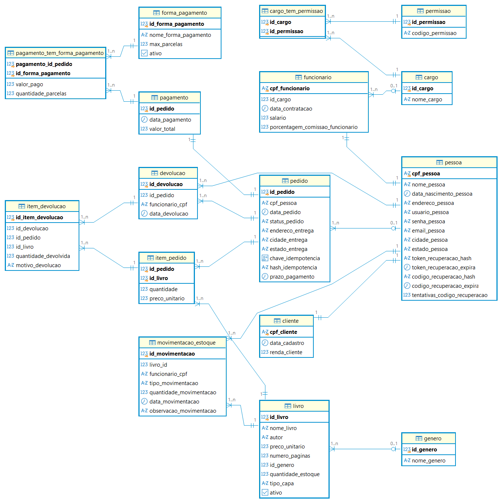

# Entre Páginas 📚

Sistema de livraria desenvolvido como projeto acadêmico da disciplina de Desenvolvimento Web I (DW1), referente ao 4º bimestre.

O **Entre Páginas** é uma aplicação web que permite aos clientes conhecer os livros disponíveis, realizar pedidos e acompanhar suas compras. Também possui uma área administrativa destinada ao gerenciamento das operações da livraria.

## 🎯 Objetivo do projeto

Desenvolver um sistema web para uma livraria, utilizando arquitetura cliente-servidor, integração com banco de dados relacional, autenticação de usuários e controle de permissões de acesso.

## ✨ Funcionalidades

### Área do cliente
- Cadastro e login de usuários.
- Recuperação de senha por e-mail.
- Visualização e consulta de livros.
- Pesquisa e filtragem de livros.
- Carrinho de compras.
- Realização e acompanhamento de pedidos.
- Pagamento dos pedidos.
- Consulta das informações da conta.

### Área administrativa
- Gerenciamento de pessoas, clientes e funcionários.
- Gerenciamento de cargos e permissões.
- Gerenciamento de gêneros literários e livros.
- Gerenciamento de formas de pagamento.
- Consulta e gerenciamento de pedidos.
- Controle de estoque.
- Registro e gerenciamento de devoluções.

## 🛠️ Tecnologias utilizadas

**Frontend**
- HTML5
- CSS3
- JavaScript

**Backend**
- Node.js
- Express
- JavaScript

**Banco de dados**
- PostgreSQL

**Bibliotecas e ferramentas**
- `pg`: conexão com o PostgreSQL.
- `bcrypt`: criptografia de senhas.
- `express-session`: gerenciamento de sessões.
- `cors`: configuração de acesso entre frontend e backend.
- `dotenv`: gerenciamento de variáveis de ambiente.
- `multer`: recebimento de arquivos.
- `sharp`: processamento de imagens.
- `nodemailer`: envio de e-mails.

## 📁 Estrutura do projeto

```text
Sofia_4bim_Livraria/
│
├── backend/
│   ├── controllers/
│   ├── middlewares/
│   ├── routes/
│   ├── database.js
│   ├── server.js
│   ├── package.json
│   ├── package-lock.json
│   └── .env
│
├── documentacao/
│   └── dw1-db-livraria3.sql
│
├── frontend/
│   ├── visaoCliente/
│   │   ├── cadastro/
│   │   ├── carrinho/
│   │   ├── informacoes/
│   │   ├── livro/
│   │   ├── login/
│   │   ├── pagamento/
│   │   ├── pedidos/
│   │   ├── index.html
│   │   ├── index.css
│   │   └── index.js
│   │
│   └── visaoGerente/
│       ├── cargo/
│       ├── cliente/
│       ├── devolucao/
│       ├── estoque/
│       ├── forma_pagamento/
│       ├── funcionario/
│       ├── genero/
│       ├── livro/
│       ├── menu/
│       ├── pedido/
│       └── pessoa/
│
├── fundos/
│
├── imagens/
│
└── README.md
```

## 🗄️ Banco de dados

O projeto utiliza PostgreSQL como sistema gerenciador de banco de dados.

O banco de dados do Entre Páginas é composto por 16 tabelas, responsáveis por armazenar e relacionar as informações de pessoas, clientes, funcionários, livros, pedidos, pagamentos, estoque e devoluções.

A seguir, estão apresentadas as tabelas e seus respectivos atributos.

**1. PESSOA**
- `cpf_pessoa` (Chave primária)
- `nome_pessoa`
- `data_nascimento_pessoa`
- `endereco_pessoa`
- `usuario_pessoa`
- `senha_pessoa`
- `email_pessoa`
- `cidade_pessoa`
- `estado_pessoa`
- `token_recuperacao_hash`
- `token_recuperacao_expira`
- `codigo_recuperacao_hash`
- `codigo_recuperacao_expira`
- `tentativas_codigo_recuperacao`

**2. CLIENTE**
- `cpf_cliente` (Chave primária e estrangeira)
- `data_cadastro`
- `renda_cliente`

**3. FUNCIONARIO**
- `cpf_funcionario` (Chave primária e estrangeira)
- `id_cargo` (Chave estrangeira)
- `data_contratacao`
- `salario`
- `porcentagem_comissao_funcionario`

**4. CARGO**
- `id_cargo` (Chave primária)
- `nome_cargo`

**5. PERMISSAO**
- `id_permissao` (Chave primária)
- `codigo_permissao`

**6. CARGO_TEM_PERMISSAO**
- `id_cargo` (Chave primária composta e estrangeira)
- `id_permissao` (Chave primária composta e estrangeira)

**7. GENERO**
- `id_genero` (Chave primária)
- `nome_genero`

**8. LIVRO**
- `id_livro` (Chave primária)
- `nome_livro`
- `autor`
- `preco_unitario`
- `numero_paginas`
- `id_genero` (Chave estrangeira)
- `quantidade_estoque`
- `tipo_capa`
- `ativo`

**9. FORMA_PAGAMENTO**
- `id_forma_pagamento` (Chave primária)
- `nome_forma_pagamento`
- `max_parcelas`
- `ativo`

**10. PEDIDO**
- `id_pedido` (Chave primária)
- `cpf_pessoa` (Chave estrangeira)
- `data_pedido`
- `status_pedido`
- `endereco_entrega`
- `cidade_entrega`
- `estado_entrega`
- `chave_idempotencia`
- `hash_idempotencia`
- `prazo_pagamento`

**11. ITEM_PEDIDO**
- `id_pedido` (Chave primária composta e estrangeira)
- `id_livro` (Chave primária composta e estrangeira)
- `quantidade`
- `preco_unitario`

**12. PAGAMENTO**
- `id_pedido` (Chave primária e estrange

### Diagrama 



## ⚙️ Configuração e execução

### 1. Pré-requisitos

Antes de iniciar, é necessário ter instalado:

- Node.js e npm.
- PostgreSQL.
- Visual Studio Code.
- Extensão Live Server do Visual Studio Code.

### 2. Configuração do backend

Abra o terminal do Visual Studio Code e entre na pasta do backend:

```bash
cd backend
```

Instale as dependências:

```bash
npm install
```

### 3. Configuração do arquivo .env

Dentro da pasta `backend`, crie um arquivo chamado `.env`.

Configure as variáveis de ambiente de acordo com as informações do seu PostgreSQL e da conta de e-mail utilizada:

```env
DB_HOST=localhost
DB_PORT=5432
DB_NAME=dw1-db-livraria
DB_USER=seu_usuario
DB_PASSWORD=sua_senha

PORT=3001

SESSION_SECRET=uma_chave_secreta

EMAIL_HOST=smtp.gmail.com
EMAIL_PORT=465
EMAIL_SECURE=true
EMAIL_USER=seu_email
EMAIL_APP_PASSWORD=sua_senha_de_aplicativo

URL_FRONTEND=http://127.0.0.1:5500
```

**Importante:** substitua os valores de exemplo pelas suas próprias configurações. Não compartilhe o arquivo `.env` nem publique senhas ou credenciais no repositório.

### 4. Inicialização do backend

Ainda dentro da pasta `backend`, execute:

```bash
node server.js
```

Se a configuração estiver correta, o terminal deverá informar que o servidor está executando na porta 3001 e que a conexão com o banco de dados foi realizada com sucesso.

O backend estará disponível em:

`http://127.0.0.1:3001`

### 5. Inicialização do frontend

1. Abra a pasta `frontend/visaoCliente` no Visual Studio Code.
2. Localize o arquivo `index.html`.
3. Clique com o botão direito sobre ele.
4. Selecione **Open with Live Server**.

O frontend será aberto no navegador, normalmente no endereço:

`http://127.0.0.1:5500`

**Observação:** o backend e o frontend precisam estar em execução simultaneamente para o funcionamento completo do sistema.

## 🔐 Segurança e configurações

- As senhas dos usuários são armazenadas utilizando hash com bcrypt.
- O sistema utiliza sessões para autenticação.
- O acesso às funcionalidades administrativas é controlado por permissões.
- As credenciais e configurações sensíveis são armazenadas em variáveis de ambiente.
- O arquivo `.gitignore` evita o envio do `.env` e da pasta `node_modules` ao repositório.

## 👩‍💻 Desenvolvimento

Projeto acadêmico desenvolvido para a disciplina de Desenvolvimento Web I (DW1), referente ao 4º bimestre.

**Nome do projeto:** Entre Páginas  
**Pasta principal:** Sofia_4bim_Livraria